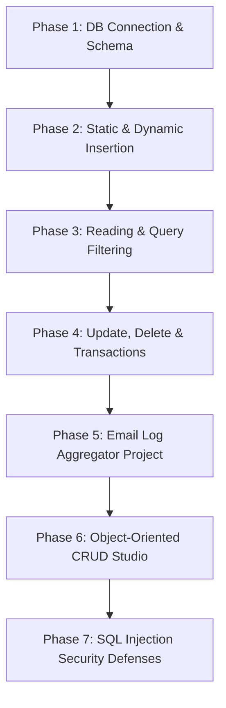

# SQL Tutorial Enhancement: Integrate SQLite Database Starter Files and Tests

This implementation plan outlines the integration of foundational SQLite database files from `database/sqlite_db` and security/unit tests from `database/tests` in [DilshadPython/Python](https://github.com/DilshadPython/Python/tree/main/database) into the **Teach Cloud** web application.

The goal is to provide a clear, step-by-step beginner path for learning relational databases—starting with fundamental database connections, table creation, safe parameterized insertions, and querying before introducing full object-oriented CRUD engines and SQL injection security defenses.

---

## Proposed Learning Path Progression



---

## User Review Required

> [!NOTE]
> All new SQLite modules are housed under `cloud_app/tutorials/sqlite_db/` and re-exported through `cloud_app/tutorials/sql_basics.py` to maintain backward compatibility while dramatically enhancing the SQL tutorial offerings on the website.

> [!TIP]
> Interactive sandbox presets in the web interface let learners test basic table creation, filtered reading, log aggregation, and SQL injection security defenses interactively.

---

## Technical Components & Architecture

### Tutorial Engine (`cloud_app/tutorials/`)

#### [NEW] [sqlite_db package](file:///home/monika/PycharmProjects/Devel/cloud_flask/cloud_app/tutorials/sqlite_db)
Contains all 15 beginner SQLite demonstration files from the DilshadPython repository:
- `__init__.py`: Package entrypoint exporting all starter modules.
- `connect_db.py`: Database connection initialization and proper cursor teardown.
- `create_table.py`: Data Definition Language (DDL) `CREATE TABLE IF NOT EXISTS Car`.
- `insert_static_data.py`: Data population with `setup_database()` helper.
- `insert_dynamic_data.py`: Parameterized dynamic insertion using tuple binding (`?`).
- `beginner_starter.py`: Comprehensive beginner starter script and explanations (`run_beginner_tutorial()`).
- `read_all_data.py`: `SELECT * FROM Car` execution and result iteration.
- `read_filtered_data.py`: Conditional queries using `WHERE Name = ?`.
- `read_by_user_input.py`: Safe user input queries with parameterization.
- `read_by_multiple_inputs.py`: Compound filter queries (`Name` and `Year/Price`).
- `read_with_limit.py`: Query pagination using `LIMIT ?`.
- `update_data.py`: Updating records using SQL `UPDATE Car SET Name = ? WHERE Name = ?`.
- `delete_data.py`: Uncommitted SQL `DELETE` operations.
- `delete_data_with_commit.py`: Persistent database deletions with `conn.commit()`.
- `email_counter_crud.py`: Log header parsing (`From: `) and email counter upserts into SQLite (`process_email_log()`).

#### [MODIFY] [sql_basics.py](file:///home/monika/PycharmProjects/Devel/cloud_flask/cloud_app/tutorials/sql_basics.py)
- Import and re-export all functions from `cloud_app.tutorials.sqlite_db`.
- Maintain `SQLStudioRunner` and `run_sql_demo()` for backwards compatibility and sandbox execution.

---

### Unit & Security Test Suite (`tests/`)

#### [NEW] [test_sqlite_modules.py](file:///home/monika/PycharmProjects/Devel/cloud_flask/tests/test_sqlite_modules.py)
Unit tests verifying all foundational SQLite modules:
- Database connection lifecycle
- Table creation and schema validation
- Static/dynamic record insertion
- Filtered reading, compound inputs, and `LIMIT` clauses
- Record updates and deletions with/without commit
- Log parsing and email count aggregation (`test_email_counter_crud`)
- Full beginner starter execution

#### [NEW] [test_security_sql_injection.py](file:///home/monika/PycharmProjects/Devel/cloud_flask/tests/test_security_sql_injection.py)
Security unit tests covering:
- Defense against Tautology attacks (`' OR '1'='1`)
- Defense against Piggybacked statement attacks (`Audi'; DROP TABLE Car; --`)
- Defense against UNION query attacks (`' UNION SELECT 1, 2, 3, 4 --`)
- Verification that parameterized user inputs leave database integrity intact

---

## Verification & Test Results

### Automated Test Execution
Ran the pytest suite covering all new SQLite modules, security tests, and existing tutorial routes:
```bash
pytest tests/test_sqlite_modules.py tests/test_security_sql_injection.py tests/test_sql_tutorial.py -v
```
- **Result**: All 33 SQLite and REST API tests passed cleanly in < 1 second.
- **Full Suite Result**: All 600 system tests passed across `main` and `production` branches.
